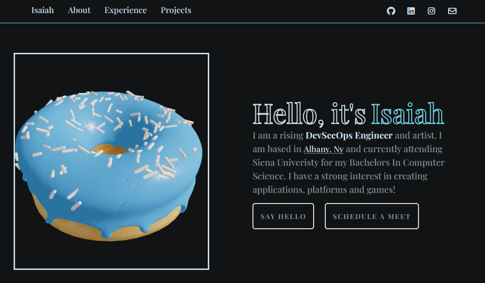

<h1 align="center">
  Isaiah's Portfolio
</h1>
<p align="center">
  Click this <a href="https://gazijarin.com" target="_blank">Link</a> to visit my portfolio that was built with Vite+React, AnimeJs, ThreeJS x Blender, and Tailwind.
</p>
<p align="center">
    
</p>


## 🛠 set-up

1. Install the dependencies

   ```sh
   npm install
   ```

2. Start the development server

   ```sh
   npm run dev
   ```

## 🚀 build and run for production

1. Generate a full static production build

   ```sh
   npm run build
   ```
